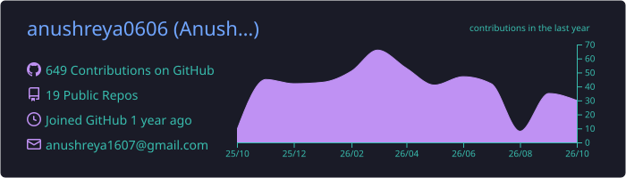
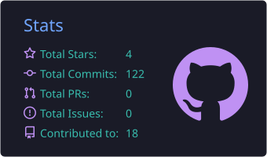
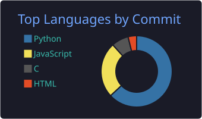

<!-- Waving banner with name -->

  

<h2 align="center">
  Hi there 
</h2>

<!-- Typing animation -->

  

  
  

---

- 🎓 B.Tech CSE (AI & ML) at **Graphic Era Deemed to be University**, Dehradun (2024–2028)
- 💼 Software Engineering Intern at **Route Mobile Limited** (Jun–Jul 2026)
- 🔭 Working on RAG systems, LLM deployment, and computer vision
- 🏆 Qualified for the Smart India Hackathon (SIH) internal round

---

**Software Engineering Intern · Route Mobile Limited** (Remote, Jun–Jul 2026)
- Evaluated Mistral, Llama, and Qwen for a *Secure GenAI Assistant for Workspace* on performance, resource needs, and privacy
- Built a FastAPI inference gateway with API-key auth and rate limiting, deployed on AWS (EC2, VPC, ALB, Redis) for private Mistral inference

---

   
   
  

Also: LangGraph · Ollama · Gemini · RAG · REST APIs · WebSockets

---

| Project | What it does | Stack |
|---|---|---|
| 🔍 [DeepTrace](https://github.com/DivyanshiSingh07-hub/Deep-Trace) | Deepfake detection for images and videos using EfficientNet-B0 and frame-level analysis | PyTorch, OpenCV |
| 🏦 [RAG Internal Knowledge Assistant](https://github.com/anushreya0606/Rag-based-internal-knowledge-assistant) | Context-grounded answers from internal policy documents | React, RAG, Vercel |
| 📚 [RAG-Powered Knowledge Base](https://github.com/anushreya0606/RAG-Powered-Knowledge-Base) | Chat with a batch of PDFs using a local LLM | Python, LLMs |
| 📈 [Sentiment-Based Stock Prediction](https://github.com/anushreya0606/Sentiment-Based-Stock-Prediction) | Classifies stock movements from news sentiment + historical data | Python, NLP, Logistic Regression |
| 🩺 [Maternal & Fetal Health Risk Predictor](https://github.com/anushreya0606/Maternal-and-Fetal-Health-Risk-Predictor) | Predicts maternal health risk from BP, age, blood glucose | Python, scikit-learn |

---

---

<!-- Generated daily by .github/workflows/profile.yml -->

  

  
  

---

<!-- Needs the GitHub Action in .github/workflows/profile.yml -->

  <picture>
    <source media="(prefers-color-scheme: dark)" srcset="https://raw.githubusercontent.com/anushreya0606/anushreya0606/output/github-snake-dark.svg" />
    
  </picture>

  

